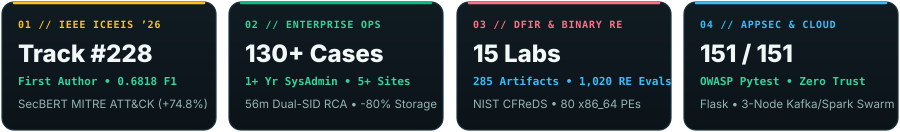

  <!-- CUSTOM CYBER EMERALD-TEAL HUD HERO BANNER -->
  

   

  <!-- DYNAMIC TELEMETRY TYPING BAR -->
  

  <!-- QUICK ACTION PILL BAR -->
  

    
    
    
    
    
  

  <!-- 4-CARD BENTO KPI DASHBOARD (5-SECOND RECRUITER SKIM) -->
  

  

## `01 //` 🛰️ Operator Dossier & Engineering Focus

<table>
  <tr>
    <td width="58%" valign="top">
      <h3>🛡️ Systems Thinker &amp; Defensive Engineer</h3>
      <ul>
        <li>🏢 <b>Enterprise SysAdmin &amp; IT Operations (Nov 2025 – Present):</b> Part-time System Administrator at <b>Global Home Group</b> across <b>5+ sites</b> (Corporate HQ, Showrooms &amp; 3 Manufacturing Plants). Administering <b>Windows Server 2022</b>, <b>Active Directory (ADUC/GPO)</b>, <b>Microsoft Entra ID / Intune</b>, <b>M365</b>, <b>SQL Server</b>, multi-floor factory WiFi/VPN, and IT Asset/License Compliance Audits (<b>130+ documented L1–L2 incidents</b>).</li>
        <li>🧠 <b>Published AI Threat Intelligence Research:</b> First Author of an accepted research abstract at <b>ICEEIS 2026 (IEEE Xplore Track #228)</b> on automated <b>MITRE ATT&amp;CK</b> TTP mapping with <b>SecBERT</b>, and co-builder of <b>SCHR-Bench</b> (<b>80 stripped <code>x86_64</code> PE binaries · 1,020 LLM reverse engineering evaluations</b>).</li>
        <li>🕵️‍♂️ <b>DFIR, AppSec &amp; Streaming Telemetry:</b> Executed <b>15 end-to-end DFIR investigations</b> (NIST CFReDS, TSK, Autopsy, RegRipper, <code>$UsnJrnl</code>), hardened production Flask web platforms behind <b>Cloudflare Zero Trust</b> (<b>151/151 Pytest</b>), and architected a fault-tolerant <b>3-node Docker Swarm Kafka/Spark/Cassandra</b> pipeline.</li>
        <li>🎓 <b>Academic &amp; Visual Systems Heritage:</b> <b>B.Sc. in Information Assurance</b> at <b>FPT University HCMC</b> (Technical Branch Member @ <b>FIA Club</b>) with a prior foundation in <b>Graphic Design</b> — combining low-level forensic precision with clear, executive-ready architecture documentation.</li>
      </ul>
    </td>
    <td width="42%" valign="top">
      <h3>📟 <code>operator_telemetry.yaml</code></h3>
<pre lang="yaml">
operator: "Tan Phat Nguyen (@phat0x8)"
status:   "OJT Ready • SOC / DFIR / SysAdmin"
base:     "Ho Chi Minh City, Vietnam"

primary_domains:
  - "Blue Team Operations &amp; DFIR Triage"
  - "Enterprise Windows/Linux SysAdmin"
  - "AI Threat Intel (MITRE ATT&amp;CK / NLP)"
  - "Web AppSec (OWASP Top 10 / Zero Trust)"
  - "Binary Reverse Engineering (x86_64 PE)"

lab_environment:
  hypervisor: "VMware Workstation Pro"
  distros:    ["Kali 2026.3", "Ubuntu 24.04", "WinServer 2022"]
  edge:       ["Cloudflare Workers", "Zero Trust Tunnel"]

opsec_policy:
  sanitization: "Strict PII / IP / Secret Redaction"
  reproducibility: "100% Verifiable Artifacts"
</pre>
    </td>
  </tr>
</table>

  

## `02 //` 🧰 Security Arsenal & Technical Toolbox

  

 

<table>
  <tr>
    <td width="50%" valign="top">
      <h4>🕵️‍♂️ Blue Team, SOC &amp; Digital Forensics (DFIR)</h4>
      

        
        
        
        
        
        
        
        
      

    </td>
    <td width="50%" valign="top">
      <h4>🏢 Enterprise Systems, Identity &amp; Networking</h4>
      

        
        
        
        
        
        
        
      

    </td>
  </tr>
  <tr>
    <td width="50%" valign="top">
      <h4>☁️ AppSec, DevSecOps &amp; Distributed Telemetry</h4>
      

        
        
        
        
        
        
        
        
      

    </td>
    <td width="50%" valign="top">
      <h4>🧠 AI Security, Reverse Engineering &amp; Embedded IoT</h4>
      

        
        
        
        
        
        
        
      

    </td>
  </tr>
</table>

  

## `03 //` 🚀 Flagship Research & Production Systems

| Project / Repository | Domain & Verification | Key Architecture & Quantitative Outcomes |
| :--- | :--- | :--- |
| 🧠 [**Secbert-cda-attack-classification**](https://github.com/phat0x8/Secbert-cda-attack-classification) <a href="https://phat0x8.nt-portfolio.workers.dev/research/secbert-mitre-attack/">📖 Read Full Case Study ↗</a> |   | **First Author Accepted Abstract (ICEEIS 2026)** — Automated **MITRE ATT&CK** TTP classification across **TRAM 1, TRAM 2 & rcATT** (`25,757+` CTI samples, `171.25×` imbalance) using **SecBERT (109M)**, Contextual Data Augmentation (`nlpaug` CDA), Iterative Stratification & Focal Loss (**+74.8% improvement** on TRAM 2). |
| 🔬 [**IAM302t_SCHR_Bench**](https://github.com/phat0x8/IAM302t_SCHR_Bench) <a href="https://phat0x8.nt-portfolio.workers.dev/research/schr-bench-llm-re/">📖 Read Full Case Study ↗</a> |   | **LLM Reverse Engineering Hallucination Benchmark** — Empirical evaluation harness testing semantic recovery vs. security-critical hallucinations across **80 stripped `x86_64` PE executables** and **1,020 decompilation evaluations** (Springer LNICST format). |
| 🏢 [**Enterprise-IT-Operations-Casebook**](https://github.com/phat0x8/Enterprise-IT-Operations-Casebook) <a href="https://phat0x8.nt-portfolio.workers.dev/casebooks/">📖 Browse Sanitized RCAs ↗</a> |  -FBBF24?style=flat-square&labelColor=0B1318) | **1+ Year Multi-Site Enterprise Operations (OPSEC-Sanitized)** — Hybrid AD / Entra ID Dual-SID Temporary Profile RCA (**56 min MTTR · 0% data loss**), SQL Server 2022 TCP/IP & ERP T-SQL differential sync, factory WiFi redesign, company-wide Asset/License Audit, and **Python + FFmpeg** archival pipeline (**132 sessions / 90+ hrs**). |
| 🕵️‍♂️ [**DFIR-Forensics-Casebook**](https://github.com/phat0x8/DFIR-Forensics-Casebook) <a href="https://phat0x8.nt-portfolio.workers.dev/casebooks/dfir-nist-cfreds-data-leakage/">📖 View NIST CFReDS Workflow ↗</a> |   | **End-to-End Digital Forensics Playbook (`FRS301`)** — 15 forensic investigations on **Kali Linux** covering the **NIST CFReDS Data Leakage** case, bit-stream disk imaging, file carving, Windows Registry (`RegRipper`), NTFS `$UsnJrnl` / `$MFT`, Prefetch, `.evtx` Event Logs, and mobile SQLite artifacts. |
| ✈️ [**GetApps-Travel-Platform**](https://github.com/phat0x8/GetApps-Travel-Platform) <a href="https://phat0x8.nt-portfolio.workers.dev/casebooks/owasp-hardening-flask-cloudflare-zero-trust/">📖 View OWASP Hardening Note ↗</a> |   | **Production Flask Platform (`ges.id.vn`) Behind Cloudflare Zero Trust** — 26 SQLAlchemy tables, proxy-aware rate limiting (`CF-Connecting-IP`), built-in **SOC Security Audit Dashboard**, strict CSP + Bleach XSS sanitization, CSRF protection, SSRF-safe redirects, and magic-byte file upload validation. |
| 🛡️ [**phat0x8-portfolio**](https://github.com/phat0x8/phat0x8-portfolio) <a href="https://phat0x8.nt-portfolio.workers.dev/">🌐 Open Live Website ↗</a> |   | **Bilingual (`EN / VI`) Cyber Emerald-Teal HUD Portfolio** — Deployed on **Cloudflare Workers Static Assets** featuring instant zero-FOUC language switching, live GitHub repository discovery, searchable Markdown casebooks with collapsible TOC & code copy, and Web Audio retro terminal SFX. |
| ⏱️ [**Smart_Digital_Clock_with_Arduino**](https://github.com/phat0x8/Smart_Digital_Clock_with_Arduino) |   | **Fault-Tolerant Embedded IoT Firmware (`IOT102`)** — Standalone Fail-Safe Offline Mode, compile-time `secrets.h` credential isolation (`CWE-798`), bounded sensor buffers (`CWE-125`), hardware unit tests (`MAX30102`, `DS1302`, `DHT11`), and Overleaf LaTeX IEEE conference paper. |
| 🌐 [**mini_blog_lab01**](https://github.com/phat0x8/mini_blog_lab01) |  | **Secure Coding Web Lab** — Defense-in-depth Flask blog implementing `Flask-WTF` CSRF tokens, Werkzeug PBKDF2 password hashing, hardened session cookies, and route-level `403` authorization checks. |

  

## `04 //` 🏅 Verified Credentials, Publications & Honors

<table>
  <tr>
    <td width="48%" valign="top">
      <h4>🏆 Honors, Publications &amp; Competitions</h4>
      <ul>
        <li>🥇 <b>Accepted Research Abstract — ICEEIS 2026 (IEEE Xplore Track #228)</b> <i>First Author · Automated MITRE ATT&amp;CK TTP Classification with SecBERT (11/2026)</i></li>
        <li>🚩 <b>Vietnam Student Information Security Contest (2025 &amp; 2026)</b> <i>National Collegiate CTF Competitor · VNISA (2025 – 2026)</i></li>
        <li>🌐 <b>Cisco NetAcad Riders 2026 (APJC Region)</b> <i>Asia Pacific, Japan &amp; Greater China Networking Competition (04/2026)</i></li>
        <li>🛡️ <b>Technical Branch Member — FPT Information Assurance Club (FIA)</b> <i>DFIR, Web AppSec &amp; Blue Team Peer Training (05/2026 – Present)</i></li>
      </ul>
    </td>
    <td width="52%" valign="top">
      <h4>📜 Verified Certifications (<a href="https://www.credly.com/users/nguyen-tan-phat.37e2d608">Credly</a> &amp; Coursera)</h4>
      <ul>
        <li>✅ <b>CyberOps Associate</b> — <i>Cisco Networking Academy (03/2026)</i></li>
        <li>✅ <b>CCNA: Switching, Routing &amp; Wireless Essentials</b> — <i>Cisco (03/2026)</i></li>
        <li>✅ <b>CCNA: Introduction to Networks</b> — <i>Cisco (11/2025)</i></li>
        <li>✅ <b>Data Analytics Essentials</b> — <i>Cisco Networking Academy (05/2026)</i></li>
        <li>✅ <b>IBM Generative AI for Cybersecurity Professionals</b> — <i>IBM (06/2026)</i></li>
        <li>✅ <b>AI Security Specialization</b> — <i>Edureka · Coursera (06/2026)</i></li>
        <li>✅ <b>Cryptography and Information Theory</b> — <i>Univ. of Colorado (10/2026)</i></li>
        <li>✅ <b>CertNexus Certified Ethical Emerging Technologist</b> — <i>(06/2026)</i></li>
      </ul>
    </td>
  </tr>
</table>

  

## `05 //` 📊 Telemetry & Contribution Activity

  
  

  

  

  
    <b>PHAT0X8.SEC</b> · Defend · Automate · Investigate ·
    <a href="https://phat0x8.nt-portfolio.workers.dev/"><b>phat0x8.nt-portfolio.workers.dev</b></a>
  

